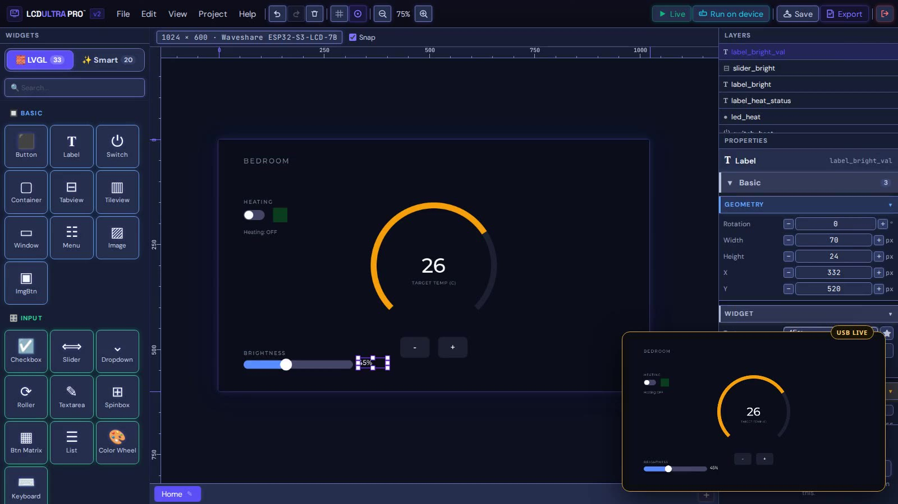
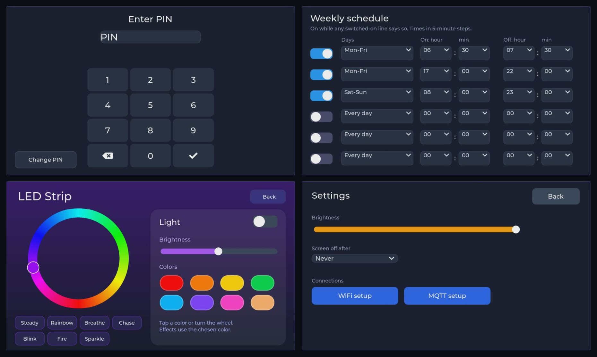

# LCD Ultra Pro

A visual LVGL editor for ESP32 display boards that runs in the browser. You pick your board, design the screens, and export an Arduino project that already has the display and touch driver for that board in it.

**Website and editor:** [lcdultrapro.com](https://lcdultrapro.com) · **YouTube:** [@LCD-UltraPro](https://www.youtube.com/@LCD-UltraPro)

This repository is the public home of the project: what it does, which boards it supports, and a place for questions and board requests. The editor itself isn't open source.

## What it does

- **Board first.** You can design for 101 ESP32 display boards, and 60 of them have a display driver ready in the export. The canvas takes the board's size and shape, round displays included. See [BOARDS.md](BOARDS.md).
- **Real LVGL on the canvas.** The editor draws with LVGL 8.4 compiled to WebAssembly, so fonts, styles and widgets look the way the panel will show them.
- **Logic without writing C.** A rule editor for button presses, screen changes, timers, GPIO, sensors and MQTT. Live Preview runs the rules in the browser before you flash anything.
- **USB Live.** On three boards the real display follows your edits while you work, over USB from the browser.
- **Ready-made screens** like a PIN lock, a weekly schedule, a thermostat, LED strip control and settings.
- **Arduino export.** A ZIP with the UI code, the rule code, `lv_conf.h`, the board driver and a README with the exact board settings. Wi-Fi and MQTT passwords stay in a local `secrets.h` and never go into the project file.

## Before you try it

- It's free during the open beta. You need an account, and projects are saved to the cloud.
- LVGL 8.4 only for now. LVGL 9 support is on the way, and ESP32-P4 boards are planned too.
- It runs in Chrome or Edge (USB Live uses Web Serial).
- I've tested the export on three boards myself. The rest are marked *ready*: the driver is there, but that board hasn't been on my desk yet.

## Free resources, even if you never use the editor

- [Board specs and pinouts](https://lcdultrapro.com/boards) for 175 ESP32 display boards
- [Wiring pages for 62 parts](https://lcdultrapro.com/parts): sensors, relays, motor drivers, level shifting
- [Blog](https://lcdultrapro.com/blog) with practical notes on the Cheap Yellow Display, touch controllers and LVGL

## Feedback and board requests

If you tried a *ready* board, I'd really like to know whether it worked. Open an issue here with the board name and what you saw, or write to support@lcdultrapro.com. Same if your board isn't on the list.

I'm actively developing it, adding more boards and features as I go.

Zsolt, Alicante, Spain

---

LCD Ultra Pro™ is developed by Zsolt Sziklai. The images and text in this repository are © Zsolt Sziklai. LVGL is a separate open-source project; LCD Ultra Pro isn't affiliated with LVGL LLC.
